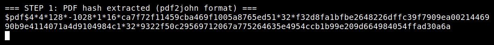
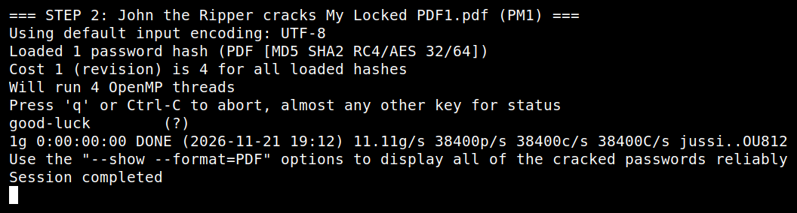
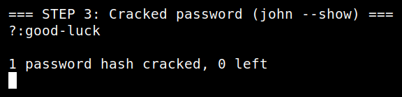
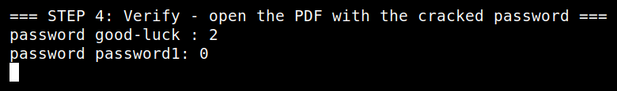
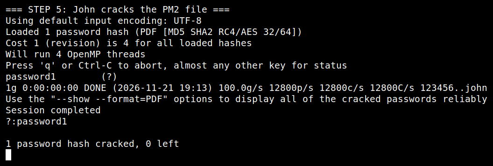
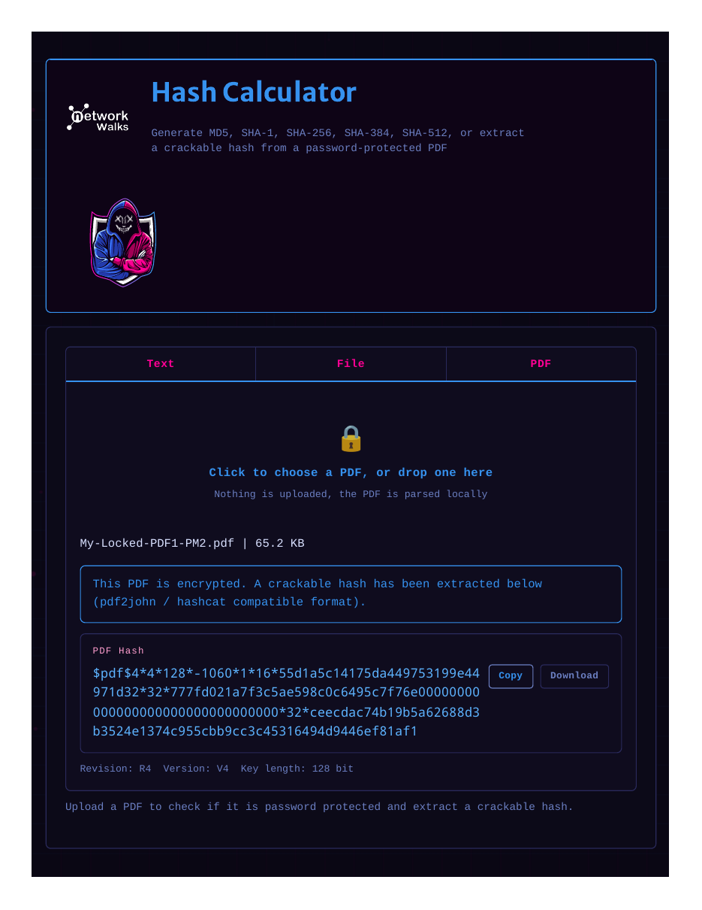
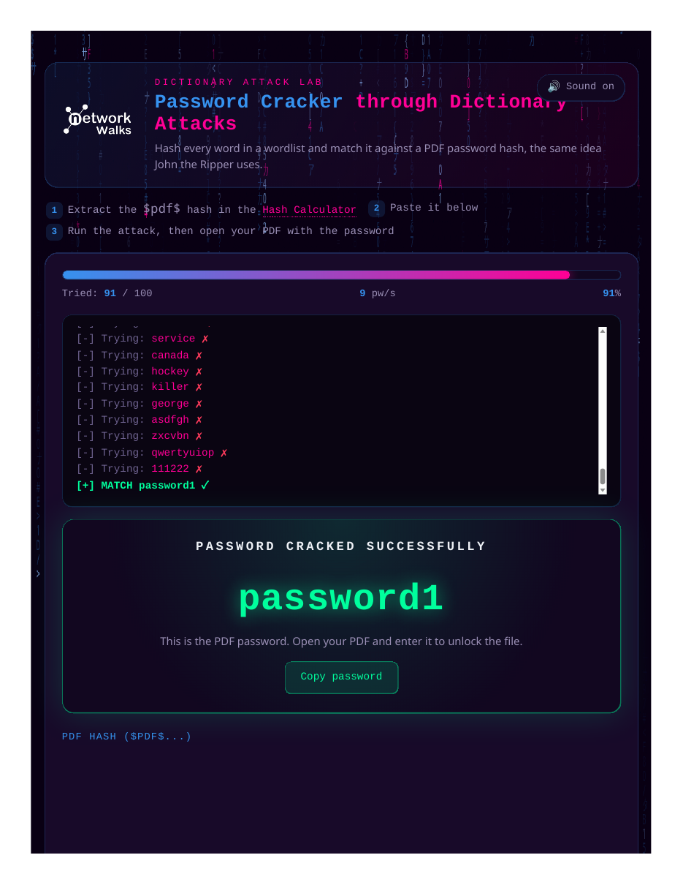
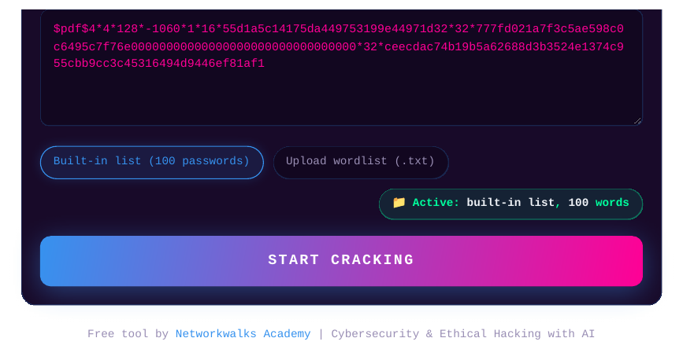

# My Week 3 Password Cracking with JTR and Networkwalks Tools

Week 3 project for Networkwalks Cybersecurity Internship, Batch B084M.
Modules: W3-PM1 Password Cracking with JTR, W3-PM2 Password Cracking with NW Tools.

Files: My Locked PDF1.pdf (PM1), My Locked PDF1 (for NW Tools Lab WK3-PM2).pdf (PM2).

## PM1 - Password Cracking with JTR

John the Ripper (jumbo 1.9.0), run on 21 November 2026.

- The PDF is encrypted with the Standard handler, Revision R4, Version V4, 128 bit key, permissions -1028.
- I extracted the hash in pdf2john format. It starts with $pdf$4*4*128*-1028*1*16*ca7f72f11459cba469f1005a8765ed51.
- John ran with the default wordlist and cracked it in under a second. Password: good-luck.
- I opened the PDF with the password to check it. It opened. The guide says the password is password1, but that is not the password of this file. password1 did not open it.

Problem faced: the john that comes with Ubuntu has no PDF format, it only knows a few old hash types. I built John the Ripper jumbo 1.9.0 from source. The build failed on blake2.h with GCC, the struct alignment in that file is wrong for new compilers. I fixed the alignment in blake2.h and the build finished. After that john listed PDF as a format.

## PM2 - Password Cracking with NW Tools

Networkwalks Hash Calculator and Password Cracker, run on 21 November 2026.

- Hash Calculator read the PM2 file and gave the hash. Revision R4, Version V4, 128 bit key, permissions -1060. The hash it gave is the same one I extracted for John, so both tools agree.
- Password Cracker tried its built in list of 100 passwords and found a match at 91 out of 100. Password: password1.
- I also cracked the same file with John. Same answer, password1.

## Report

See week3-report.md for the full report.

## outputs/

Text outputs of each step. 1-pdf-hash.txt and 1-pdf-hash-pm2.txt are the extracted hashes. 2-john-crack-pm1.txt and 3-john-crack-pm2.txt are the John runs with the --show output.

Note: this lab was run in the Linux lab VM, not in Kali, because the Kali VM was stopped that day. Same tools, same files, same results.
